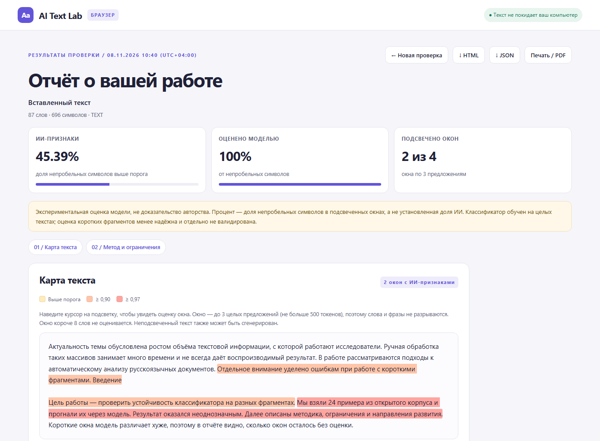

# AI Text Lab — браузерная версия

Статичный сайт без сборки и без сервера: `index.html` + несколько ES-модулей.
Модель скачивается в браузер и выполняется на устройстве пользователя через
WebAssembly (onnxruntime-web). Текст никуда не отправляется, API-ключи не нужны.
Сайт можно опубликовать на GitHub Pages как есть.

В веб-версии есть только проверка на ИИ-признаки: карта текста, доли
подсвеченного и оценённого текста, таблица оценок по окнам и экспорт отчёта.
Механические проверки, структура работы, нормоконтроль оформления DOCX и
оформленная копия остались в Python-приложении.

Текст классифицируется не произвольными кусками, а **целыми предложениями**:
вы задаёте, сколько предложений брать на одно окно (по умолчанию 3), и подсветка
совпадает с границами фраз. Токенный режим остался для сравнения с Python-версией.



## Быстрый запуск

ES-модули не работают по `file://`, поэтому нужен любой локальный HTTP-сервер:

```sh
cd ai-text-model/web
python -m http.server 8000
# откройте http://127.0.0.1:8000
```

## Публикация на GitHub Pages

1. Создайте репозиторий и скопируйте **содержимое папки `web/`** в его корень
   (`index.html` должен лежать в корне, рядом — `assets/` и `model/`).
2. Закоммитьте и отправьте:

   ```sh
   git init
   git add .
   git commit -m "AI Text Lab: browser build"
   git branch -M main
   git remote add origin https://github.com/<user>/<repo>.git
   git push -u origin main
   ```

3. В GitHub: **Settings → Pages → Build and deployment → Source: Deploy from a branch**,
   ветка `main`, папка `/ (root)`. Сохраните.
4. Через минуту сайт откроется по адресу `https://<user>.github.io/<repo>/`.

Вариант с папкой `/docs`: положите файлы в `docs/`, выберите папку `/docs` и
опубликуйте оттуда. Файл `.nojekyll` уже есть — он отключает обработку Jekyll.

Сборка не нужна: нет `package.json`, нет шага `npm run build`, нет зависимостей,
которые надо устанавливать. Единственный внешний ресурс — onnxruntime-web с
jsDelivr и веса модели с Hugging Face (см. ниже).

## Откуда берутся веса

По умолчанию файлы скачиваются с Hugging Face по закреплённой ревизии
`00141fe7ab18291ef0c4ab75bc00c0797e590a8b` (та же, что в `download_model.py`):

- `tokenizer.json` — 4,7 МБ;
- `model_int8.onnx` — 36 МБ (по умолчанию);
- `model.onnx` — 140 МБ (вариант fp32, как в Python-версии).

Браузер кэширует их, поэтому повторные проверки не требуют загрузки.
Текст при этом не передаётся: скачиваются только веса модели.

### Свои веса рядом с сайтом

GitHub Pages разрешает файлы до 100 МБ, поэтому `model_int8.onnx` (36 МБ) можно
хранить в репозитории, а fp32 — нет.

1. Скопируйте `tokenizer.json` и `model_int8.onnx` в `model/`.
2. Впишите имена файлов в `model/manifest.json`:

   ```json
   { "files": ["tokenizer.json", "model_int8.onnx"] }
   ```

3. Всё. Пока манифест пуст, сайт ходит на Hugging Face; если файл перечислен,
   он загружается с вашего домена (`fetch` того же источника, без CORS).

## Как устроено

| Файл | Назначение |
| --- | --- |
| `index.html` | разметка формы и отчёта |
| `assets/config.js` | репозиторий, ревизия, лимиты, порог и окно по умолчанию |
| `assets/tokenizer.js` | порт `tokenizer.json`: NFC → added tokens → ByteLevel pre-tokenizer (GPT-2 regex) → BPE; отдаёт id и смещения в UTF-16 |
| `assets/analyze.js` | правила нормализации из `inference.json`, окна по предложениям или токенам, доли подсвеченного и оценённого текста |
| `assets/sentences.js` | разбиение на предложения (`Intl.Segmenter`) и сборка окон по N целым предложениям с лимитом токенов |
| `assets/engine.js` | загрузка onnxruntime-web, скачивание весов с прогрессом, сессия WASM/WebGPU, softmax |
| `assets/documents.js` | чтение DOCX (ZIP + `DecompressionStream` + `DOMParser`) и TXT (UTF-8/UTF-16/CP1251) |
| `assets/report.js` | карта текста с подсветкой, отчёт, автономный HTML-экспорт |
| `assets/app.js` | связка формы, прогресса и отчёта |

Ключевые решения:

- **Окна по предложениям (по умолчанию).** Текст делится на предложения
  (`Intl.Segmenter`, запасной regex), затем группируется по N целых предложений —
  столько, сколько указал пользователь (по умолчанию 3). Подсветка никогда не
  начинается и не заканчивается посреди слова или фразы.
- **Лимит контекста соблюдается.** Если группа предложений не влезает в
  контекст модели (500 токенов), она дробится по границам предложений; если
  длиннее само предложение — оно режется по токенам и помечается в таблице
  как «1 (длинное)».
- **Токенный режим сохранён** для сравнения с Python-версией (`app.py`), там
  границы по-прежнему идут по токенам.
- **Токенизатор написан на чистом JS.** Это избавляет от второго WASM-файла
  (ещё ~5 МБ) и даёт точные смещения в координатах JavaScript. Совпадение с
  Python-версией проверено на 34 наборах текста.
- **Веса не хранятся в репозитории**: 140 МБ не влезают в лимит GitHub Pages.
- **Только проверка на ИИ-признаки.** Механические проверки, проверка структуры,
  нормоконтроль оформления DOCX и оформленная копия в веб-версию не входят —
  они остались в Python-приложении.

## Режим по предложениям

В блоке «Настройки анализа»:

- **предложений на окно** — 1–20, по умолчанию 3;
- **минимум слов в окне** — окна короче не оцениваются; по умолчанию 8 для
  предложений и 20 для токенов (поле запоминает ручное значение);
- **порог подсветки** — 0,8 по умолчанию.

Один запрос к модели — одно окно, состоящее из целых предложений. Поэтому
подсветка («этот фрагмент похож на ИИ») совпадает с границами фраз, а в
таблице видно, сколько предложений было в окне и какая у него оценка.

Короткие окна модель различает хуже, чем целые документы. Если выбрать
1 предложение и высокий минимум слов, часть окон останется без оценки — отчёт
прямо скажет, сколько окон пропущено и что поменять.

## Совместимость и проверка

Проверено в headless Chrome 156 (WebAssembly, int8 и fp32) на локальном сервере
и с загрузкой весов с Hugging Face:

- fp32: расхождение с Python-версией `onnxruntime` ≤ 2·10⁻⁸ на всех окнах;
- int8: расхождение с Python `onnxruntime` (та же квантованная модель) ≤ 3·10⁻⁵;
- границы окон и доли подсветки совпадают с `app.py` в токенном режиме;
- окна по предложениям: проверено, что границы совпадают с началом и концом
  предложений, окна не пересекаются и покрывают весь видимый текст, лимит
  500 токенов соблюдается, длинное предложение делится на части;
- текст в карте восстанавливается один-в-один (проверка `textContent`);
- DOCX: 281 символ, 9 абзацев, таблица — текст совпадает с `thesis.read_docx`;
- отчёт содержит только проверку на ИИ-признаки: разделов «Проверки»,
  «Механики» и ручного чек-листа нет, в JSON отсутствует ключ `audit`;
- экспорт HTML и JSON, мобильная ширина 390 px — без горизонтальной прокрутки.

Скорость: одно окно (до 500 токенов, WASM, одно ядро) — int8 ≈ 0,1–0,25 с,
fp32 ≈ 0,15–0,3 с в десктопном Chrome. Первая загрузка int8 занимает
5–10 с в зависимости от сети.

Требования к браузеру: Chrome/Edge 120+, Firefox 120+, Safari 17+. Для DOCX
нужен `DecompressionStream('deflate-raw')`; без него сайт попросит обновиться
(вставка текста и TXT работают всегда).

## Ограничения

- Это оценка модели, а не доказательство авторства: softmax не калиброван,
  короткие окна (меньше «минимума слов», по умолчанию 8–20) не оцениваются.
- Окно по предложениям — всё равно один независимый запрос к модели: суждение
  относится ко всей группе предложений, а не к отдельному слову. Модель обучена
  на целых текстах, поэтому короткие фрагменты она различает менее устойчиво.
- Однопоточный WASM: на GitHub Pages нельзя включить `SharedArrayBuffer`
  (нужны заголовки COOP/COEP), поэтому большие документы считаются дольше.
  Лимит — 200 000 символов, как в Python-версии.
- WebGPU включается опцией «Авто» и может дать другой результат на нестандартных
  драйверах; по умолчанию используется WASM.
- В веб-версии нет проверки оформления DOCX, механических проверок, проверки
  структуры, оформленной копии, CLI и локального сервера — это Python-приложение.
- Сайт не отправляет текст на сервер, но сам факт открытия страницы и загрузки
  весов виден Hugging Face и jsDelivr (это обычные GET-запросы без текста).

## Лицензии

- Модель: [toiletsandpaper/russian-ai-text-detector-modernbert](https://huggingface.co/toiletsandpaper/russian-ai-text-detector-modernbert), Apache-2.0.
- onnxruntime-web: MIT.
- Код сайта — как и остальной проект AI Text Lab.
